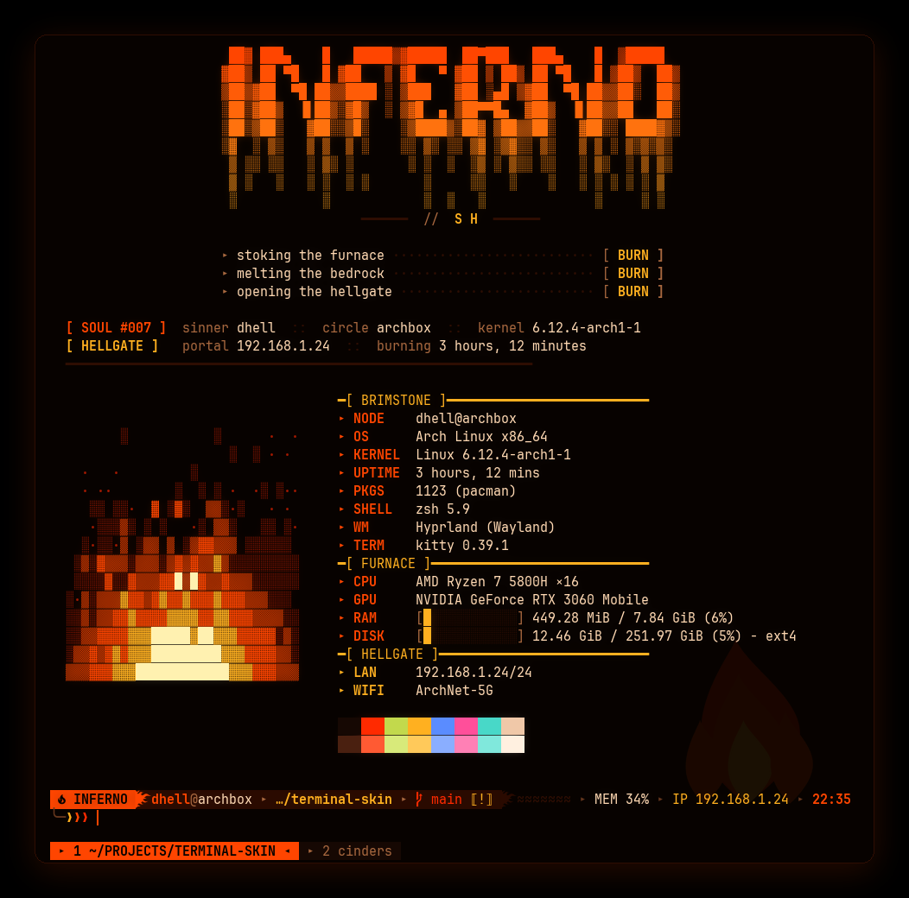

# INFERNO//SH

> **Hell series · Theme 11** — Lava, ember and hellfire. Flames between every prompt segment.



---

## What you get

| Layer | Details |
|-------|---------|
| **Boot sequence** | A DOOM-style fire burns across the screen → the banner burns in from the bottom → a 3-step launch log → a briefing with your real user, host, kernel, IP and session number → fastfetch |
| **Prompt** (starship) | Two-line HUD, one solid bar — the tag melts into your path through flame-shaped separators. User@host, path, git branch/status and language versions on the left; command time, MEM, IP, battery and clock on the right |
| **System info** (fastfetch) | Logo: a frame of the classic DOOM fire. Sections: `BRIMSTONE` · `FURNACE` · `HELLGATE`, with themed usage bars |
| **Terminal** (kitty) | Full 16-color palette, beam cursor with a trail, faint flame watermark, themed tabs |
| **Shell** (zsh) | Syntax highlighting + autosuggestions in theme colors, `eza`/`bat` colors, handy aliases |

---

## Palette

| Role       | Color |
|------------|-------|
| Background | `#070200` |
| Foreground | `#ffd9b3` |
| Primary    | `#ff4500` |
| Secondary  | `#ffb020` |
| Accent     | `#ff2a00` |
| Muted      | `#a8683f` |
| Dim        | `#2e0d02` |

---

## Install

```bash
git clone https://github.com/Dhellss/Terminal-skin
cd Terminal-skin/inferno-sh
chmod +x install.sh
./install.sh
```

The installer will:
- Install the required packages via pacman
- Back up your existing configs (`.bak-TIMESTAMP`) before replacing them
- Copy the configs into `~/.config/`
- Add one source line to `~/.zshrc` (and switch off any other Terminal-skin theme so they never stack)
- Offer to make zsh your default shell

Then open a new kitty window.

## Uninstall

```bash
cd Terminal-skin/inferno-sh
./uninstall.sh
```

Puts your previous configs back from the newest `.bak-*` files and disables the theme in `~/.zshrc`.

---

## Kitty shortcuts

| Shortcut | Action |
|----------|--------|
| `ctrl+shift+m` | Open a `cinders` tab (cmatrix in red) |
| `ctrl+shift+i` | Show fastfetch in an overlay (any key closes it) |
| `ctrl+shift+enter` | Vertical split in the current folder |
| `ctrl+shift+a` then `↑` / `↓` | Window opacity up / down |

## Aliases

| Alias | Does |
|-------|------|
| `boot` / `ignite` | Replay the full opening sequence |
| `info` / `brimstone` | fastfetch |
| `rain` / `cinders` | cmatrix in theme color |
| `ls`, `ll`, `tree` | eza with icons |
| `cat` | bat, no paging |
| `update` / `install` | `sudo pacman -Syu` / `sudo pacman -S` |
| `scan` / `myip` | open ports / public IP |

---

## Tweaks

**Quick boot (skip the animation, fastfetch only)** or **no boot at all** — edit the line near the top of `~/.config/inferno-sh/inferno-sh.zsh`:

```bash
sed -i 's/INFERNO_BOOT:-full/INFERNO_BOOT:-quick/' ~/.config/inferno-sh/inferno-sh.zsh   # or :-off
```

Press `ctrl+c` during the boot to skip it once.

---

## Notes

- Every symbol in this theme exists in **JetBrainsMono Nerd Font** (installed by the installer), so nothing shows up as an empty box.
- The boot banner needs a window at least 63 columns wide; smaller windows get a one-line title instead.
- `percent.type: 3` in fastfetch shows a bar + number. On a very old fastfetch, change it to `1`.
- The battery and Wi-Fi lines only appear on machines that have them.
